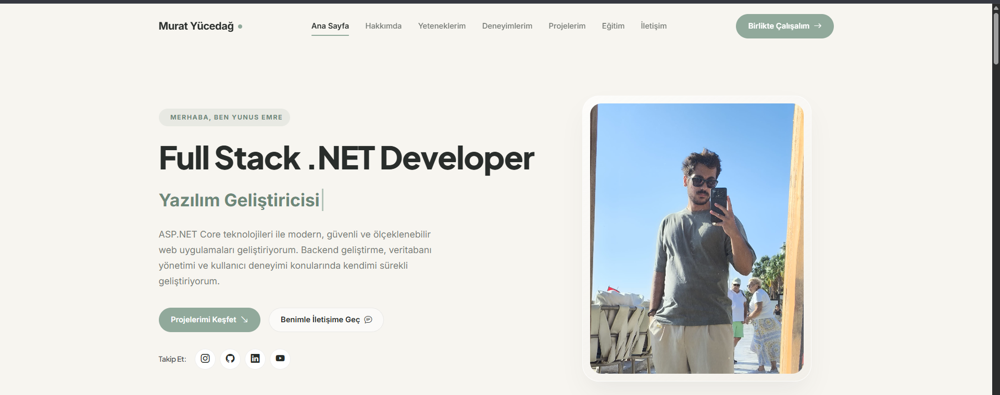
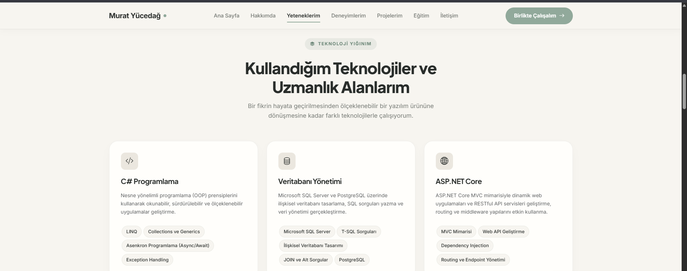
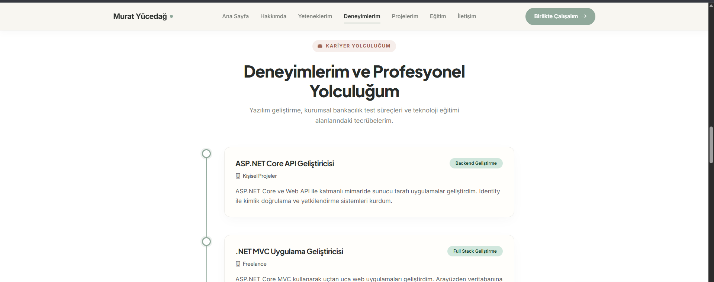
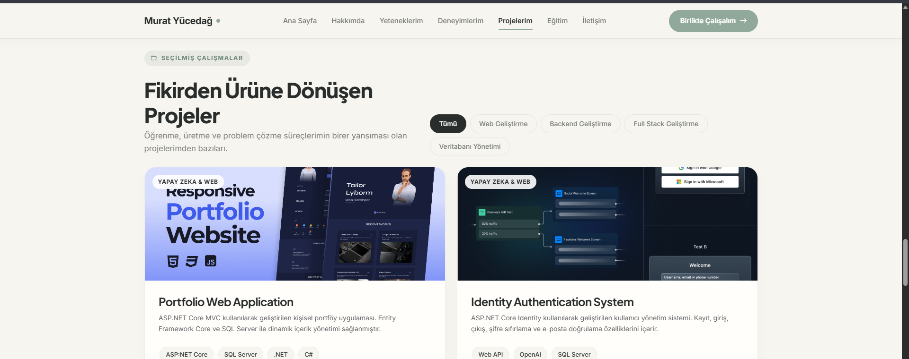

# Dinamik Kişisel Portfolyo ve Yönetim Paneli

ASP.NET Core MVC ile geliştirilen, içerikleri SQL Server veritabanından yönetilen kişisel portfolyo uygulaması. Ziyaretçiler portfolyo içeriklerini görüntüleyebilir ve iletişim formunu kullanabilir; içerikler ve mesajlar yönetim alanından takip edilir.

## Özellikler

- Veritabanından yönetilen karşılama alanı ve aktif unvanlar
- Kategori ve teknoloji ilişkileriyle listelenen projeler
- Hakkımda, eğitim, deneyim, yetenek, sosyal medya ve iletişim içerikleri için yönetim ekranları
- Hakkımda alanı için görsel ve CV PDF yükleme desteği
- İletişim mesajlarını kaydetme, mesaj ayrıntılarını ve okundu durumunu yönetme
- Toplam/okunmamış mesajlar, okuma oranı, son mesajlar ve son yedi güne ait mesaj istatistikleri
- ASP.NET Core MVC Areas ile ayrılmış Admin alanı
- ViewComponent tabanlı, tekrar kullanılabilir arayüz bileşenleri
- Entity Framework Core Code First migration'ları

## Kullanılan Teknolojiler

- .NET 9 ve ASP.NET Core MVC
- Entity Framework Core 9, SQL Server ve LINQ
- Razor, ViewComponent ve Areas
- Bootstrap 5 ve JavaScript

## Ekran Görüntüleri

  

  

  

  

  

> Ekran görüntüleri sunum amacıyla eklenmiştir. Kişisel CV PDF dosyaları depoya dahil edilmez.
