# Dinamik Kişisel Portfolyo ve Yönetim Paneli

ASP.NET Core MVC ile geliştirilen, içerikleri SQL Server veritabanından yönetilen kişisel portfolyo uygulaması. Ziyaretçiler portfolyo içeriklerini görüntüleyebilir ve iletişim formunu kullanabilir; içerikler ve mesajlar yönetim alanından takip edilir.

## Özellikler

- Veritabanından yönetilen karşılama alanı ve aktif unvanlar
- Kategori ve teknoloji ilişkileriyle listelenen projeler
- Hakkımda, eğitim, deneyim, yetenek, sosyal medya ve iletişim içerikleri için yönetim ekranları
- Hakkımda alanı için görsel ve CV PDF yükleme desteği
- İletişim mesajlarını kaydetme, mesaj ayrıntılarını ve okundu durumunu yönetme
- Toplam/okunmamış mesajlar, okuma oranı, son mesajlar ve son yedi güne ait mesaj istatistikleri
- ASP.NET Core MVC Areas ile ayrılmış Admin alanı
- ViewComponent tabanlı, tekrar kullanılabilir arayüz bileşenleri
- Entity Framework Core Code First migration'ları

## Kullanılan Teknolojiler

- .NET 9 ve ASP.NET Core MVC
- Entity Framework Core 9, SQL Server ve LINQ
- Razor, ViewComponent ve Areas
- Bootstrap 5 ve JavaScript

## Ekran Görüntüleri

  

  

  

  

  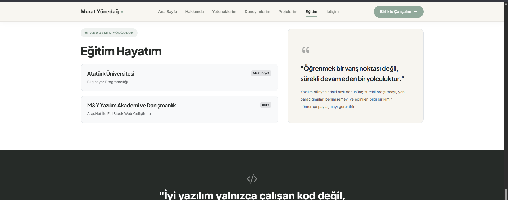

## Admin Paneli Ekran Görüntüleri

  
Dashboard ve istatistikler

  

    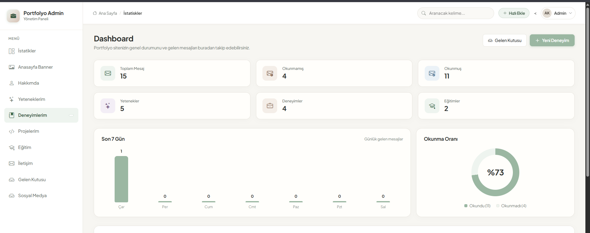
  

  

    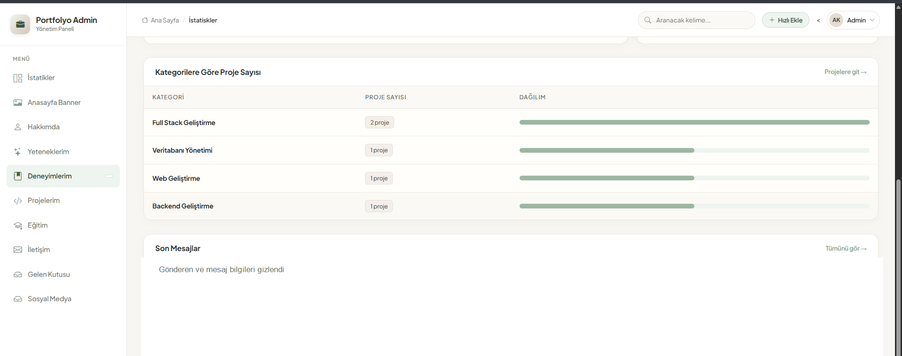
  

  
Ana sayfa bannerı ve hakkımda

  

    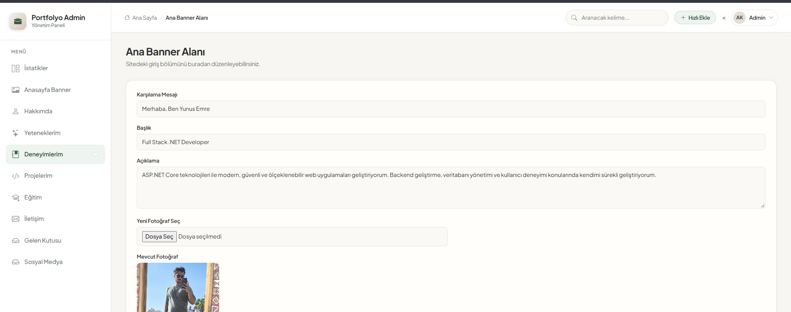
  

  

    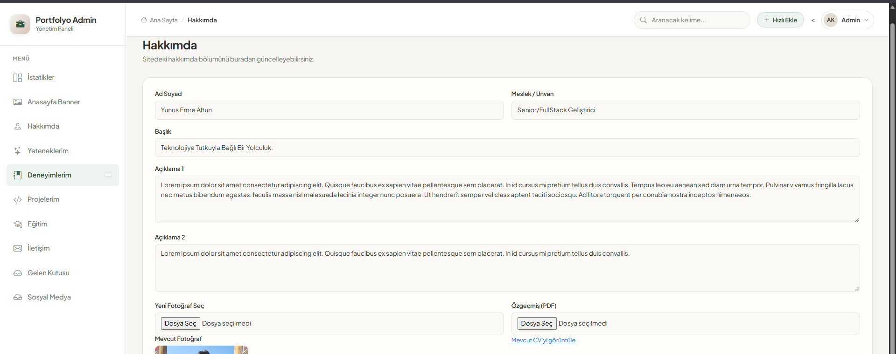
  

  
Yetenekler

  

    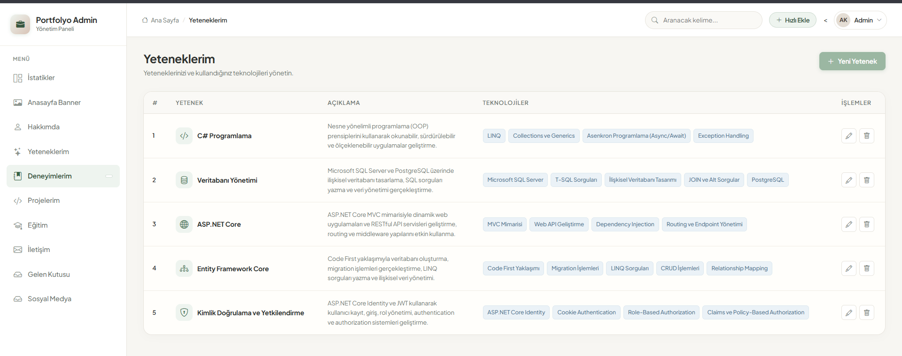
  

  

    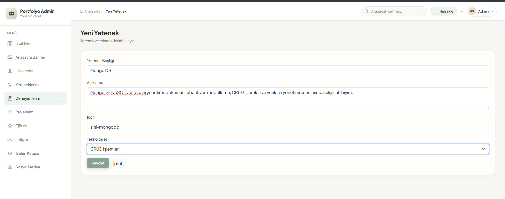
  

  
Projeler

  

    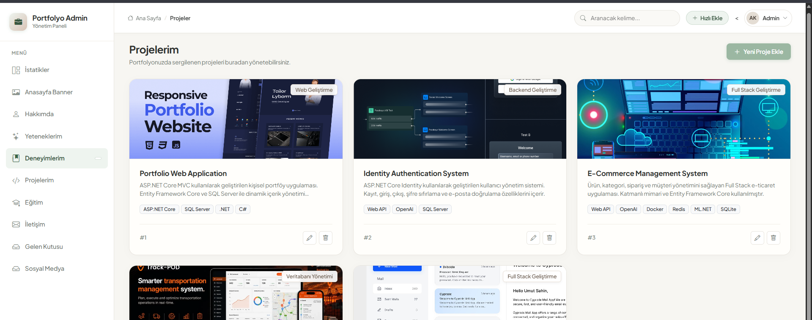
  

  

    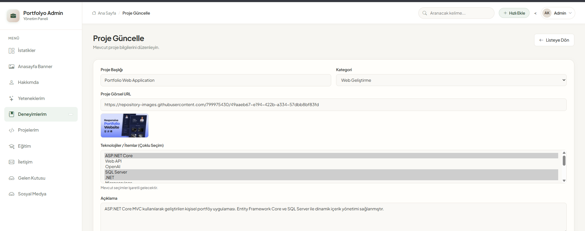
  

  

    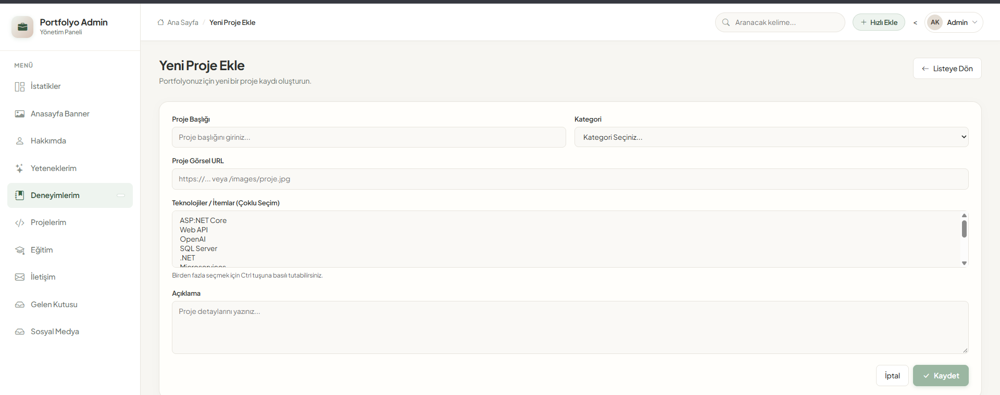
  

  
Deneyimler

  

    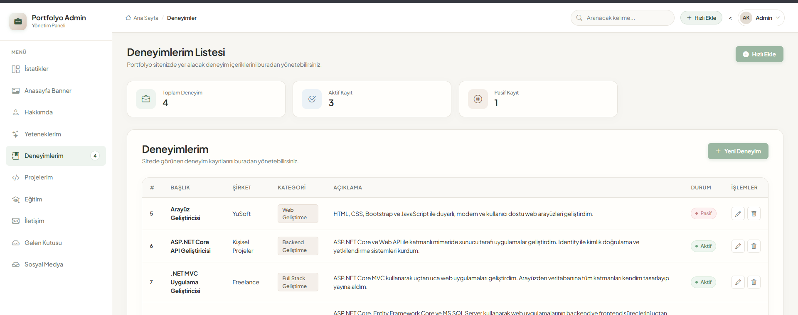
  

  

    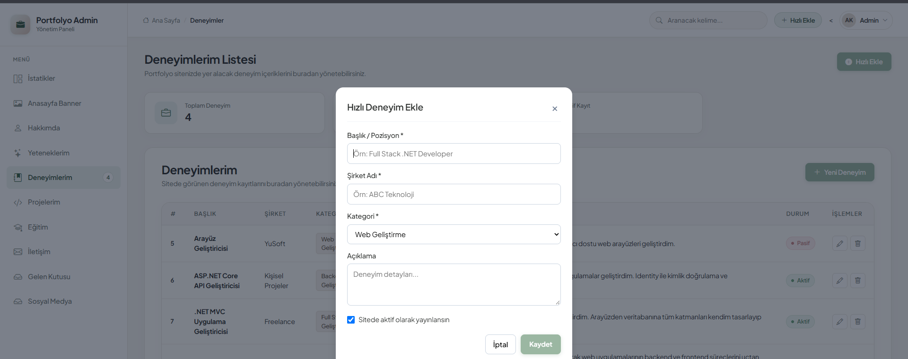
  

  
Eğitim

  

    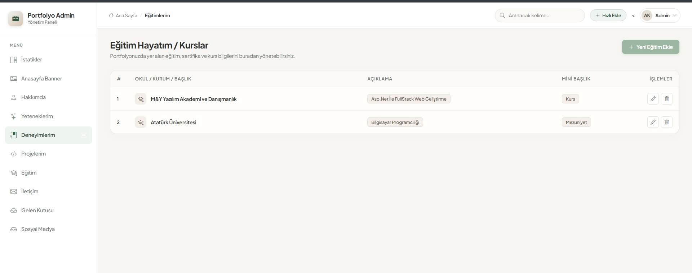
  

  
İletişim bilgileri

  

    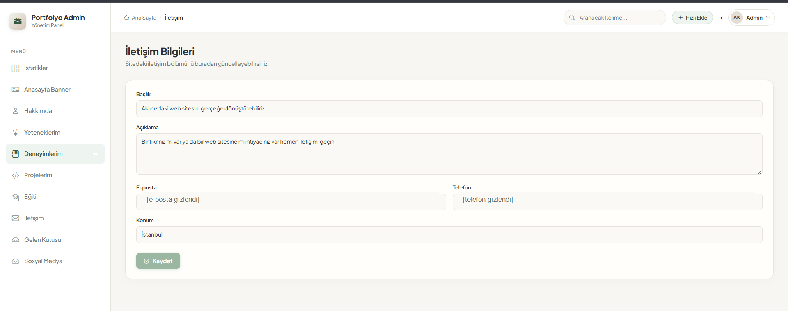
  

  
Gelen mesajlar

  

    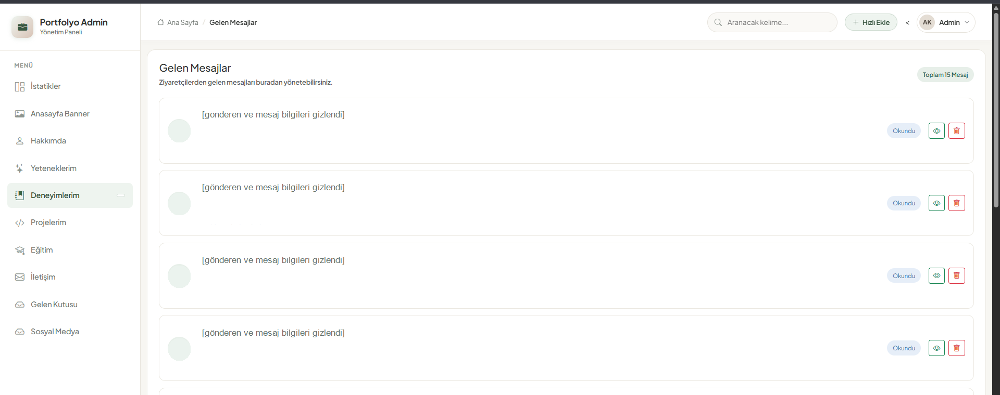
  

  

    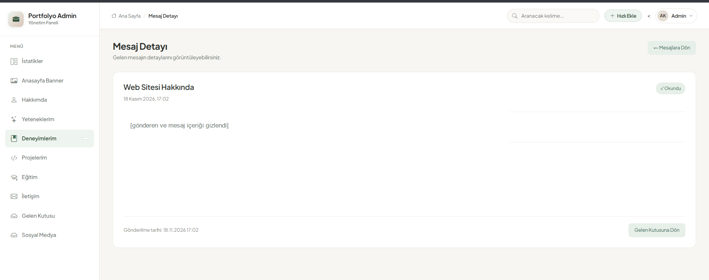
  

  
Sosyal medya hesapları

  

    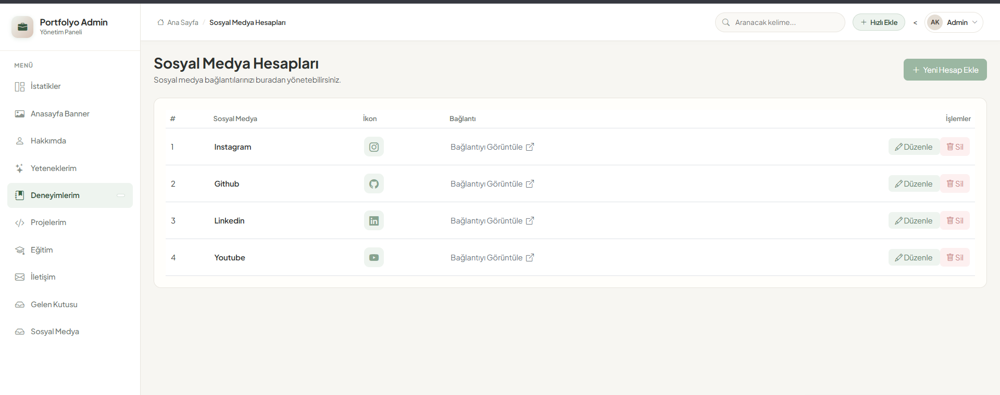
  

  

    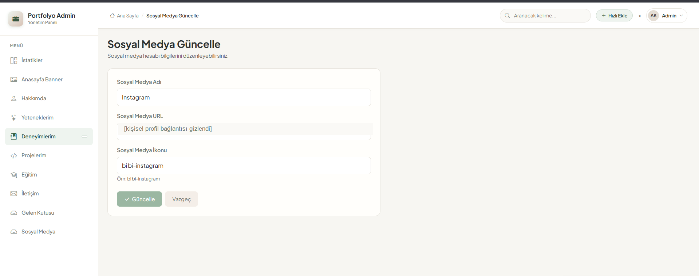
  

> Ekran görüntüleri sunum amacıyla eklenmiştir. Kişisel CV PDF dosyaları depoya dahil edilmez.
> Admin ekran görüntülerinde e-posta, telefon, kişisel profil bağlantısı ve ziyaretçi mesajı gibi özel bilgiler gizlenmiştir.
